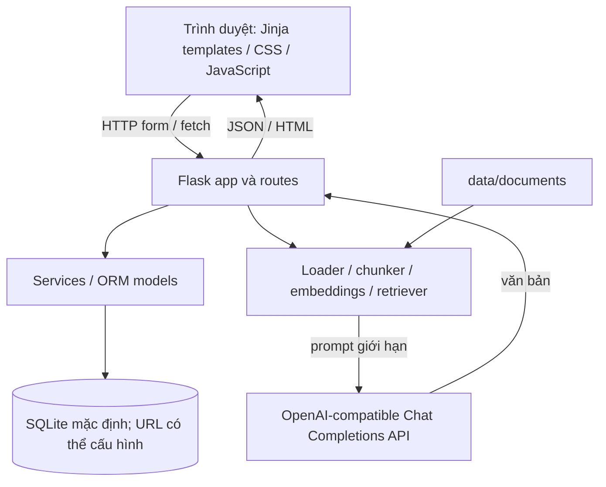
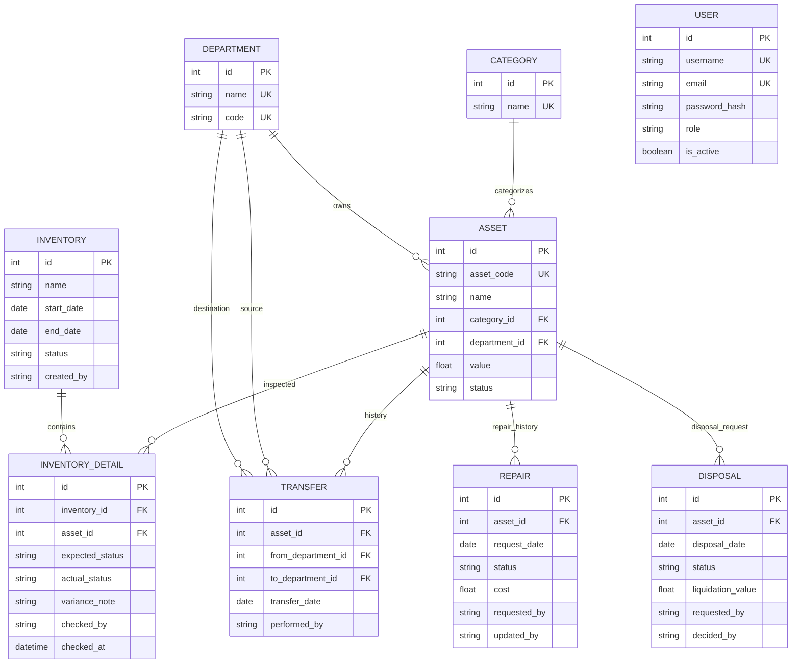

# Kiến trúc hiện tại

## Thành phần

## Luồng dữ liệu quan trọng

- `app.py` tạo ứng dụng qua `app.create_app`; routes được đăng ký tại `app/routes/__init__.py`.
- SQLAlchemy models ở `app/models/`; cơ sở dữ liệu mặc định đặt tại `database/school_assets.db`.
- RAG đọc tài liệu ở `data/documents/`, chunk và truy xuất trong bộ nhớ; mã hiện không lưu vector DB bền vững.
- AI report truy vấn số liệu thực tế trong `app/routes/ai.py`; LLM được gọi server-side qua `app/llm/llm_service.py`. API key không được gửi tới trình duyệt.
- Cấu hình lấy từ `.env` (không commit); chạy cục bộ mặc định bind `127.0.0.1` và debug tắt.

## Lược đồ dữ liệu đang có

## Thiết kế so với hệ thống đang chạy

- Hiện có `Category`, `Department`, `Asset`, `Inventory`, `InventoryDetail`, `InventoryObservation`, `Transfer`, `Repair`, `Disposal`, `User`; không có bảng `Location`, `Role`, AI report hoặc audit log riêng.
- `Asset.location` hiện là chuỗi tự do. Phòng ban là quan hệ có khóa ngoại.
- Kiểm kê snapshot tài sản ngoài trạng thái thanh lý; kết quả thực tế gồm tình trạng, người kiểm và thời điểm. `InventoryObservation` chứa tài sản quan sát được nhưng không thuộc snapshot. Campaign chỉ khóa sau khi mọi tài sản kỳ vọng có kết quả.
- Sửa chữa có trạng thái `pending`/`in_progress`/`completed`/`cancelled`; thanh lý có trạng thái yêu cầu và quyết định admin. Các actor được lưu trực tiếp trên workflow, nhưng không có audit log sự kiện đầy đủ.
- Schema ORM do SQLAlchemy `create_all` tạo; startup còn chạy bổ sung cột SQLite additive/idempotent cho các workflow mới. `database/schema.sql` là tài liệu SQL độc lập, không phải migration đang được chạy. Chưa có migration versioned.
- CSRF/RBAC được áp dụng ở backend; report AI cho phép chọn phòng ban/đợt kiểm kê. Chưa có ACL theo phòng ban cho từng user.
- `database/backup.py` hỗ trợ backup/restore SQLite sang file mới và kiểm tra integrity; chưa có lịch backup hoặc production restore drill. `/health` chạy query DB, không thay thế readiness/monitoring production.

