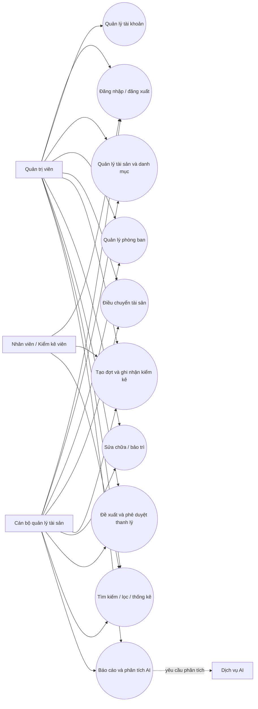

# Actor và Use Case

## Sơ đồ

Dịch vụ AI là hệ thống phụ trợ được gọi từ backend, không đăng nhập hoặc tự quyết định quyền truy cập.

## Luồng chính

### Đăng nhập

1. Người dùng gửi tên đăng nhập và mật khẩu.
2. Backend xác minh hash mật khẩu và trạng thái tài khoản.
3. Hợp lệ thì tạo session mới; sai hoặc bị khóa thì từ chối mà không tiết lộ tài khoản có tồn tại hay không.
4. Người dùng đăng xuất thì session bị xóa.

**Hiện trạng:** login/logout/session đã có; kiểm tra mật khẩu sai và bảo vệ dashboard bằng test. Logout hiện dùng GET và CSRF chưa được triển khai cho biểu mẫu thay đổi dữ liệu.

### Quản lý tài sản

1. Người dùng nhập trường bắt buộc và metadata.
2. Backend xác thực mã duy nhất, ngày, giá trị, trạng thái và danh mục/phòng ban.
3. Backend lưu và trả thông báo; tìm kiếm lọc bằng tham số ORM.

**Hiện trạng:** create/list/search/edit/delete routes tồn tại; test xác nhận tạo, tìm kiếm, mã trùng và giá âm. Rà soát đầy đủ quyền, lỗi ngày và vòng đời tài sản còn cần bổ sung.

### Điều chuyển

1. Chọn tài sản, nguồn, đích, ngày và lý do.
2. Backend xác nhận tồn tại, nguồn đúng phòng ban hiện tại, đích khác nguồn và tài sản đang hoạt động.
3. Cập nhật phòng ban hiện tại và thêm bản ghi lịch sử trong cùng transaction.

**Hiện trạng:** bước 2–3 được triển khai và có test thành công/từ chối nguồn sai/trạng thái sai/ID sai.

### Kiểm kê, sửa chữa và thanh lý

Luồng đích cần lưu người thực hiện, thời gian, chi tiết, trạng thái và phê duyệt. Ứng dụng hiện chưa có các luồng đầy đủ này; không được ghi nhận là hoàn tất.

### Báo cáo AI

1. Backend xác thực người dùng và loại báo cáo.
2. Backend truy vấn dữ liệu thật, áp dụng quyền/phạm vi truy cập.
3. Backend giới hạn prompt và gọi API LLM nếu có cấu hình; nếu thiếu key hoặc lỗi, giữ lại thống kê thật và thông báo rõ.
4. UI hiển thị nguồn dữ liệu, trạng thái chờ/lỗi và cảnh báo AI chỉ hỗ trợ tham khảo.

**Hiện trạng:** có trang báo cáo thống kê và lời gọi API LLM tổng quát; chưa có báo cáo sai lệch cho một đợt kiểm kê cụ thể, tóm tắt phòng ban có chọn phạm vi, hoặc gợi ý thay thế có căn cứ lịch sử.
